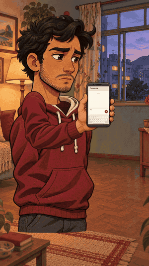

# A mensagem no rascunho

**21 segundos · cartoon ilustrado · narração em português · sem música**

[**Baixar o MP4 com voz**](cartoon-mensagem.mp4?raw=true)

Personagem original com cabelo, roupa e expressões, em um apartamento desenhado. O vídeo alterna retrato, detalhe de digitação e gesto de envio. A mensagem é escrita e apagada; depois do toque, sai do rascunho e aparece na conversa, e o personagem relaxa.

A técnica é animação 2D por recortes ilustrados em camadas: cabeça, braço/celular e mão de toque são animados separadamente. Não é uma sequência de fotos, um boneco geométrico nem geração de vídeo de corpo inteiro.

[Projeto editável e skill usada](cartoon-mensagem-projeto.zip?raw=true) · [Storyboard e roteiro](storyboard.md) · [Legendas](legendas.srt)

## Verificação e limites

Arquivo decodificado, duração e áudio verificados; quadros examinados a cada 0,5 s e no contato/envio. A revisão de áudio foi técnica, sem escuta disponível. O tutorial do YouTube não pôde ser acessado; a direção de arte segue a descrição da revisão 2 da skill enviada, sem alegar comparação direta com o tutorial.

Ilustrações e efeitos originais. Voz local Kokoro pm_alex, modelo Apache-2.0 e runtime MIT. Fontes e licenças no projeto. As versões anteriores foram preservadas.
