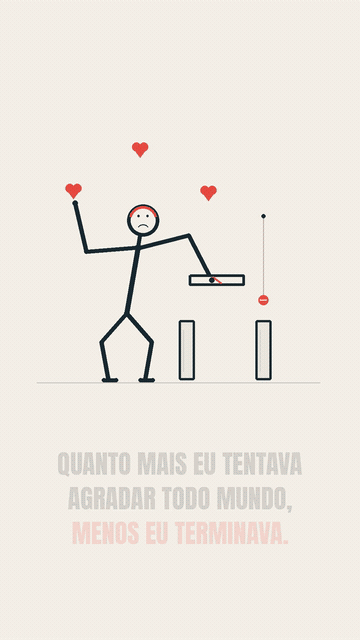

# Stickman: O que você constrói fica

**21 segundos · narração em português · vertical Full HD**

[**Baixar o vídeo com narração (MP4)**](stickman-pro.mp4?raw=true)

O boneco se distrai com sinais de aprovação, deixa a peça cair, tenta construir uma ponte, ajusta o apoio depois do erro e termina uma ponte que funciona. Personagem de linhas, sem corpo humano preenchido ou cenas no computador.

[Projeto editável, áudio e skill utilizada](stickman-projeto.zip?raw=true) · [Roteiro](roteiro.md) · [Legendas](stickman-legendas.srt)

Verificados arquivo, duração, dimensões, rig, contatos, colisões e sequências de quadros do MP4. O áudio foi verificado tecnicamente; não houve revisão por escuta. Amostragem de quadros não comprova reprodução integral fluida.

Voz local Kokoro pm_alex, modelo Apache-2.0 e runtime MIT. Fonte Anton, SIL Open Font License. Efeitos e desenhos originais. As versões anteriores foram preservadas em outputs/video-viral.
