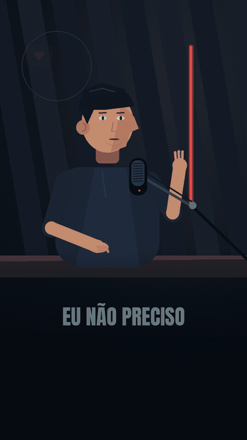

# Nova versão: animação 2D com narração

18 segundos · 1080 × 1920 · 30 fps · voz em português brasileiro.

## Prévia animada (sem som)

## Vídeo com som

[Baixar o MP4 com narração](animacao-com-voz.mp4?raw=true)

Personagem falando e gesticulando, mãos digitando, chuva, trabalho na tela e corrida com braços e pernas animados. As legendas acompanham os trechos da narração. A boca acompanha a energia da fala, sem sincronização fonética precisa.

## Arquivos

- [Vídeo MP4](animacao-com-voz.mp4?raw=true)
- [Projeto editável, código e áudio](animacao-projeto.zip?raw=true)
- [Legendas SRT](animacao-legendas.srt)
- [Roteiro](animacao-roteiro.md)

Voz sintetizada com Kokoro local, separadamente do VoiceStudio. Modelo Apache-2.0, runtime MIT. VoiceStudio 0.5.7 instalado e API verificada no ambiente; sua síntese interna não foi usada neste vídeo. Fonte Anton: SIL Open Font License, incluída no projeto.

A versão anterior com fotografias permanece em final.mp4 para comparação.
